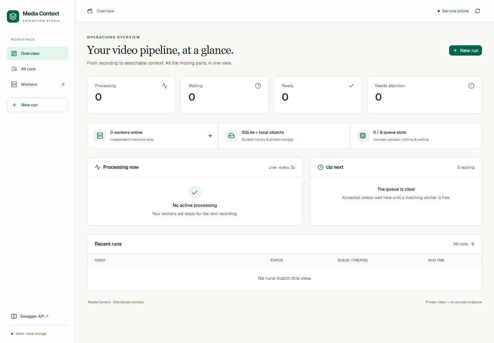
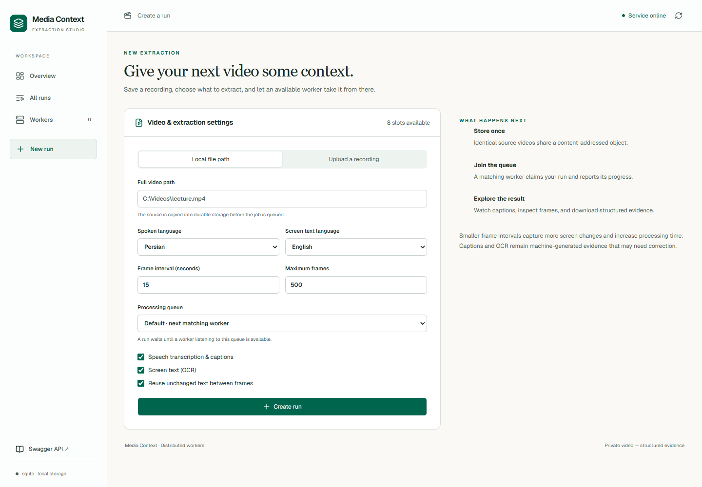
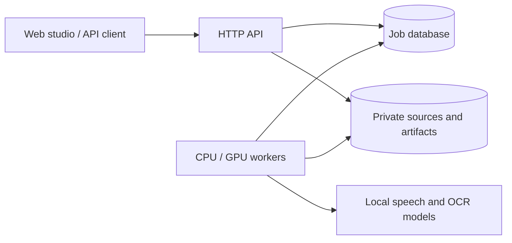

# Media Context Studio

**Turn media into structured, searchable context.**

A self-hosted extraction service and web workspace that turns recordings into timestamped evidence. Extract speech, on-screen text, scene boundaries, and frames; inspect them alongside the original video; and retrieve structured results through an HTTP API.

Built for course recordings, presentations, and applications that need grounded source material for later analysis.

[Getting started](#getting-started) · [Deployment](docs/production.md) · [Dashboard](docs/dashboard.md) · [API reference](docs/service.md)

## Studio preview

The operations overview brings processing, queue capacity, workers, and recent runs into one workspace.



Choose a recording, configure speech and OCR, and select a processing queue.



Screenshots show a fresh local workspace with no recordings or run history.

## Features

- **Video extraction:** speech transcription, scene detection, sampled frames, and OCR with repeated-text deduplication.
- **Evidence workspace:** video playback, captions, transcript search, frame seeking, time-range queries, and durable run history.
- **Portable results:** JSON, Markdown reports, SRT/WebVTT captions, and selectable ZIP or TAR.GZ downloads.
- **Durable workers:** database-backed queues, leases, crash recovery, cancellation, retry, and resource reporting.
- **Local inference:** speech and OCR run on your machine after model preparation, without an external inference API.
- **Flexible storage:** SQLite and local files for laptop use; PostgreSQL and private S3-compatible storage for deployments with independent CPU/GPU workers.
- **Private access:** API-key authentication and browser sessions when configured. The Docker setup generates credentials.

## Input support

| Input | Status |
| --- | --- |
| Video recordings, including their audio tracks | Supported |
| Standalone audio files | Planned |
| Standalone images | Planned |

The name reflects the intended direction. Standalone audio and image ingestion are not implemented yet.

## Getting started

### Docker stack

Requires Git, Python 3.12 or 3.13 for setup helpers, and Docker with Compose. Application runtimes and media tools are included in the images.

```sh
git clone https://github.com/ammahmoudi/media-context-studio.git
cd media-context-studio
python scripts/setup_env.py
docker compose build api worker
python scripts/start_stack.py
```

On a fresh deployment, prepare speech and OCR weights before submitting jobs:

```sh
docker compose run --rm worker python -m video_context.cli prepare-models --ocr-language en
```

Open **<http://127.0.0.1:18765/>**, sign in with `VIDEO_CONTEXT_API_KEY` from the generated `.env`, and upload a video through **New run**. Interactive API documentation is at **<http://127.0.0.1:18765/docs>**, using the same browser session.

The stack includes an API, a CPU worker, PostgreSQL, and RustFS object storage. Model preparation needs internet access; prepared models can be reused offline. Keep `.env` private. The setup helper preserves existing credentials.

See the [deployment guide](docs/production.md) for worker sizing, native GPU workers, configuration, backups, and external hosting.

### Local Python mode

Requires Python 3.12 or 3.13 and `ffmpeg` / `ffprobe` on `PATH`. On Windows PowerShell:

```powershell
python -m venv .venv
.\.venv\Scripts\python.exe -m pip install -e '.[worker,dev]'
.\.venv\Scripts\python.exe -m video_context.cli prepare-models --ocr-language en
.\.venv\Scripts\python.exe -m video_context.cli serve
```

On Linux/macOS, use `.venv/bin/python` for the same commands. Local mode uses persistent SQLite, local object files, and an embedded worker. The built dashboard is included. Stop any API already using port `18765`, or pass `serve --port 18766`.

The Python module, CLI, and `VIDEO_CONTEXT_*` configuration names remain unchanged for compatibility.

## API example

Upload a recording with your service key. In a POSIX shell, set `VIDEO_CONTEXT_API_KEY` in your environment and run:

```sh
curl --fail-with-body http://127.0.0.1:18765/v1/jobs/upload \
  -H "X-API-Key: $VIDEO_CONTEXT_API_KEY" \
  -F 'file=@lecture.mp4' \
  -F 'options_json={"language":"en","ocr_language":"en"}'
```

The response contains a job ID. Use the same authentication header for these requests:

| Endpoint | Purpose |
| --- | --- |
| `GET /v1/jobs/{id}` | Status and progress |
| `GET /v1/jobs/{id}/result` | Structured extraction result |
| `GET /v1/jobs/{id}/context?start=60&end=120` | Evidence in a time range |
| `GET /v1/jobs/{id}/artifacts/context.md` | Readable report |
| `GET /v1/jobs/{id}/artifacts/captions/speech.srt` | Speech captions |

Retrieve results when extraction has finished. Speech and OCR languages are independent; omit `language` for automatic speech-language detection. Prepare the selected OCR model profile before using it.

## Architecture



Workers extract evidence on the source timeline and publish artifacts per attempt. Repeated runs can share an original video while retaining separate results. PostgreSQL and S3-compatible storage support independent API and worker processes; laptop mode uses SQLite and local files.

## Development

Install Python dependencies using the local setup above. To rebuild the frontend:

```sh
pnpm --dir web install --frozen-lockfile
pnpm --dir web build
pnpm --dir web lint
```

Run the automated tests with your project Python environment:

```sh
python -m pytest -q -p no:cacheprovider
```

Integration tests require the database and object store and are opt-in. See the [validation notes](docs/validation.md) and [deployment guide](docs/production.md). Historical [full-course measurements](docs/full-course-validation.md) and [optimization notes](docs/optimization.md) describe the tested hardware and recording, not universal performance guarantees.

## Scope and limitations

The service extracts evidence. Semantic summaries, speaker identification, vision-model interpretation of diagrams, and equation-to-LaTeX conversion are not implemented. Speech and OCR can make mistakes; sparse frame sampling can miss brief content. Verify important observations against the source recording.

The bundled deployment is a single-node baseline. External hosting needs HTTPS, explicit host/cookie configuration, resource controls, and tested database/object-store backups. Authentication uses a single service key rather than a multi-user permission system.

## Roadmap

- Standalone audio ingestion and transcription.
- Standalone image ingestion and OCR.
- A common context representation across media types.

These are future directions rather than current capabilities or delivery commitments.

## Documentation

- [Deployment, queues, storage, GPU workers, access, and backups](docs/production.md)
- [Dashboard and run workflows](docs/dashboard.md)
- [API and extraction details](docs/service.md)
- [Research and original scope](docs/video-context.md)

Some detailed notes describe earlier versions and local experiments; the deployment guide covers the durable architecture. Videos, model weights, databases, and credentials are excluded from Git.
