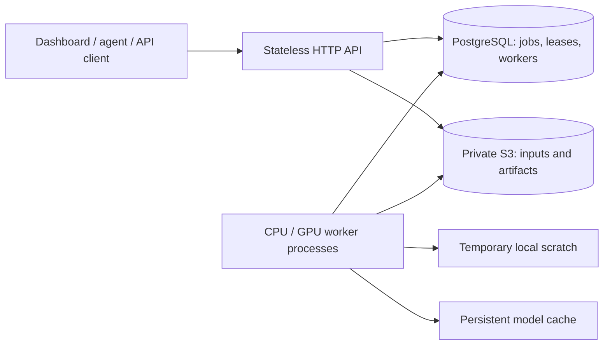

# Durable service and deployment

This deployment replaces the original in-memory queue/JSON history with a database-backed service. PostgreSQL and S3-compatible storage are the deployed backends; SQLite and local object files remain available for laptop use. The original course evidence is preserved.

## Components and ownership



| Data | Location | Lifetime |
| --- | --- | --- |
| Job options, state, progress, attempts, artifact pointers | PostgreSQL; SQLite in laptop mode | Retained across API/worker restarts |
| Original video | Private S3 object keyed by source SHA-256 and suffix | Retained for playback and retry; repeated runs share the input |
| Context JSON, report, SRT, WebVTT, frames | Private per-job/per-attempt S3 prefix | Published only after upload finishes |
| Decoded audio, downloaded inputs, temporary outputs | Worker scratch directory | Removed after the attempt exits normally |
| Speech/OCR weights | Persistent model cache | Reused across runs; excluded from Git/images |
| Deployment credentials | Ignored `.env` or injected environment | Shared securely across API replicas; excluded from Git |

The database has schema version 1 and initializes tables under an advisory lock on PostgreSQL. Unsupported schema versions are rejected. Future schema changes require explicit migrations rather than silently changing existing tables.

## Queue and resource behavior

The database itself is the durable queue; Redis is not required. API replicas reserve queue capacity transactionally and finish storing input before making a job runnable. PostgreSQL workers claim eligible jobs using `FOR UPDATE SKIP LOCKED`. SQLite uses serialized write transactions and WAL mode for laptop operation.

States are `uploading → queued → running → complete / partial / failed`, with `cancelled` available for queued/running jobs. `GET /v1/jobs` includes live work, paginated/filterable history, queue positions, counts, and worker resources. Search and history filters are server-side.

- Each worker process runs one job at a time and retains its loaded model between jobs.
- Workers sample resources/report heartbeats about every two seconds. The UI considers a worker offline after 30 seconds.
- A running job's default lease is 120 seconds, renewed independently of slow scene detection/inference. Production workers mark expired attempts failed, requiring an explicit retry after inspecting memory/container events. This prevents repeating an OOM job after each restart. The lower-level database claim API retains optional bounded crash retries for integrations that explicitly choose them.
- Ownership checks fence progress/final-state updates. Attempt-specific object prefixes prevent a stale worker from overwriting a newer attempt's published artifacts.
- Execution is not exactly once. An explicit retry after a partition can overlap with an old worker until it detects lease loss. Only the owner can publish the database result pointer.
- Cancellation updates durable state immediately; computation stops at its next progress checkpoint. A long decoder/scene scan may take time to reach that checkpoint.
- Retry creates a new job linked by `retry_of`, reusing the source object. Published partial/failed evidence is retained.
- The `default` and `cpu` queues are handled by the default Docker CPU worker. The laptop GPU worker listens to `gpu`. The UI prefers the GPU queue when a matching GPU worker is online.
- Shared resource domains limit concurrent execution transactionally across replicas. The default is one active CPU run per domain and one GPU run per physical device. Give workers on the same host/device the same domain, including native and container workers. Separate hosts/devices need distinct domains. Raising `VIDEO_CONTEXT_MAX_PARALLEL` requires a measured memory budget.

The worker page shows process CPU/RAM/threads, available memory and its host/cgroup limit, sampled process-tree peak RAM, queue subscriptions, model, current job, heartbeat age, and GPU device memory/utilization. Workers waiting for resources show the reason. Each new run stores sampled peak RAM and whole-device VRAM in its database record; context exports include the pre-publication sample. GPU memory includes other applications, not an allocation exclusive to this service.

## OOM and scratch protection

- Transcription reads **120-second core windows with two seconds of context on each side**, bounded to 300 seconds even if misconfigured higher. PCM audio is on disk; a 57-minute recording no longer creates a complete float waveform and speech-feature array in RAM. A default window's waveform is at most about **7.6 MiB**. Words are assigned to a single core by midpoint to avoid duplicate overlap captions. Windowing can change recognition/segmentation near boundaries; it does not validate transcription accuracy.
- Before claiming work, workers require 1,536 MiB available RAM and 2,048 MiB scratch space. Linux checks the smaller of host availability and remaining cgroup memory, allowing for reclaimable inactive file cache. GPU workers require fresh telemetry, with 3,072 MiB free VRAM for a cold model or 768 MiB for an already-loaded model. Running jobs tolerate a telemetry timeout using the last successful reading for at most ten seconds; longer telemetry loss fails closed.
- During work, resource sampling/checkpoints enforce 384 MiB RAM and 256 MiB VRAM headroom plus the scratch reserve. Pressure fails the current job with `resource_exhausted`; it does not silently publish a partial success. Native allocation/OOM errors also fail the job. Waiting for resources does not consume an attempt.
- Docker worker hard limit is 4 GiB, with a 3,584 MiB cooperative process-tree budget. API/PostgreSQL limits are 512 MiB each; storage is 1 GiB. Memory+swap limits equal RAM limits, avoiding swap thrashing. The steady default stack totals **6 GiB** in configured hard limits. The init container is separately capped at 256 MiB.
- Windows standalone workers install a **6 GiB Job Object commit limit including child processes**, failing startup if it cannot be installed. This includes FFmpeg. Embedded laptop workers only have cooperative checks; use the standalone worker or Docker for hard isolation. Linux standalone workers require a container/systemd cgroup for hard isolation.
- Inputs exceeding six hours or 3,840×2,160 decoded pixels are rejected before scene decoding. Scene count is capped at 5,000; OCR observations and speech segments at 50,000 each; structured context at 16 MiB. These guardrails are configurable where exposed in `.env.example`. Individual frames stay on disk, and model inference remains sequential.
- Audio scratch capacity is checked using estimated PCM size before decoding. Downloads reserve twice input size plus the free-space floor. Upload concurrency is two per API process, parsed context reads are serialized with a memory admission check, API connections are capped at eight, and body byte limits apply to chunked requests before multipart parsing. Docker multipart temporary files live on `/data`, with disk checks while receiving/copying. Overload returns 429/503; insufficient upload scratch returns 507. Database pools are bounded to four connections per process, with five-second PostgreSQL connect/lock and fifteen-second statement timeouts.

Hard limits contain failure; they cannot guarantee an individual job will never OOM. Cooperative checks cannot interrupt a native model/decoder allocation already in flight. GPU VRAM is shared with desktop/other apps and has no hard per-process cap here. Peak readings are sampled roughly every two seconds and can miss short spikes. Run measured workloads before raising concurrency; resource admission is deliberately conservative.

## Storage backend choice

The S3 adapter uses boto3 and supports AWS S3, compatible MinIO endpoints, and RustFS. The bundled stack uses **RustFS 1.0.4**. The [original MinIO community repository](https://github.com/minio/minio) was archived on April 25, 2026. [RustFS](https://github.com/rustfs/rustfs) is maintained and S3-compatible; its upstream had approximately 35.9k stars when checked on November 9, 2026. No existing MinIO containers from other projects were changed.

The bucket is private. Authenticated API endpoints stream video byte ranges and artifacts without buffering entire videos or exposing storage credentials. The original SRT remains downloadable; browser captions use a generated WebVTT representation of the same timed transcript. Video codec compatibility still depends on the browser; automatic video transcoding is not implemented.

Normal processing removes scratch files. `gc-work` lists abandoned scratch directories from interrupted processes; `--apply` removes eligible old directories while excluding live job IDs. It never deletes durable source/result objects. Durable history and artifacts are retained by default. Configure and test a retention/backup policy before operating an unbounded video library; do not expire shared source objects while retained jobs reference them. Abandoned ingestion reservations are marked failed after two hours.

## Start the Docker stack

Docker must be running. Generate credentials once:

```powershell
python scripts/setup_env.py
docker compose build api worker
python scripts/start_stack.py
```

Open <http://127.0.0.1:18765/> and sign in with `VIDEO_CONTEXT_API_KEY` from `.env`. The API, worker, PostgreSQL, and object store have separate containers and persistent volumes. API containers do not install ML inference runtimes. Images use pinned Python dependency snapshots, a locked frontend, cached dependency layers, non-root application processes, health checks, and CPU/memory limits.

Ports are API `18765`, PostgreSQL `55433`, S3 `19020`, and storage console `19021`, bound to localhost. The Docker-backed service now owns the main API URL on this laptop; the earlier SQLite API process was stopped, with its database/files preserved. Change `VIDEO_CONTEXT_HTTP_PORT` to run another instance. The console uses `S3_ACCESS_KEY` / `S3_SECRET_KEY` from `.env`.

The default model cache is a named volume. Before submitting speech/OCR jobs on a fresh deployment, prepare the weights:

```powershell
docker compose run --rm worker python -m video_context.cli prepare-models --ocr-language en
```

This laptop uses `VIDEO_CONTEXT_MODELS_VOLUME=./.models` in its ignored `.env` to reuse existing weights. On Linux, use the named-volume default or ensure the chosen bind mount is writable by UID 10001. Models are not downloaded by normal analysis jobs.

To scale CPU workers:

```powershell
python scripts/start_stack.py --cpu-workers 2 --check-only
```

The startup helper checks combined configured limits, current usage of unrelated containers, 1 GiB Docker headroom, and at least 2 GiB host availability. It refuses unsafe starts/scales, including the optional GPU container when capacity is insufficient. Re-run without `--check-only` after sizing passes. A second replica also needs 4 GiB budget even though the default shared domain serializes inference; increase domain concurrency only after measuring peaks. Direct `docker compose up` bypasses this aggregate check. Each worker defaults to four CPUs. API replicas share PostgreSQL/S3, but publishing multiple replicas on one fixed host port requires a reverse proxy/load balancer. The bundled single PostgreSQL and single object-store node are persistent local services, **not a high-availability deployment**.

## Use this laptop's NVIDIA GPU

Keep the native CUDA setup and connect an independent GPU worker to the Docker database/object store:

```powershell
.\.venv\Scripts\python.exe scripts/with_stack.py worker --queues gpu
```

Submit GPU jobs with `"queue": "gpu"`, or use the dashboard. The helper reads connection credentials from `.env` without putting them in process arguments or printing them. Native workers continue using the laptop's selected `large-v3-turbo` / CUDA / `int8_float16` settings.

An optional Linux CUDA container target/profile is also provided:

```powershell
docker compose --profile gpu build gpu-worker
python scripts/start_stack.py --gpu
```

It requires a working NVIDIA container runtime/GPU passthrough and the model weights in the shared cache. The CUDA image tag was verified; the GPU-container profile has not been built or runtime-validated on this laptop. The native GPU-worker path is used for local validation. Choose one GPU-worker path per physical GPU.

## Access and external hosting

The Docker stack requires a generated API key. Tools send `X-API-Key`; the dashboard exchanges the key for a 12-hour HttpOnly, SameSite browser session. Keys are not stored in browser local storage or query strings. Cookie-authenticated cross-origin writes are rejected. Swagger and private artifact/video routes require the same authentication; UI assets and basic health/readiness endpoints are public.

Server-side path submission is disabled in Docker; upload files instead. It remains enabled in laptop mode. For an external deployment, put the API behind HTTPS, set `VIDEO_CONTEXT_SECURE_COOKIE=1`, configure exact `VIDEO_CONTEXT_ALLOWED_HOSTS`, and inject credentials through your deployment secret manager. This is a single-tenant service key, not a multi-user identity/permission system. Use restricted S3 service credentials for an existing production bucket; the local stack credentials are intended to initialize this private local instance.

Relevant configuration:

| Variable | Purpose |
| --- | --- |
| `VIDEO_CONTEXT_DATABASE_URL` | SQLAlchemy PostgreSQL URL or SQLite file URL |
| `VIDEO_CONTEXT_S3_ENDPOINT`, `VIDEO_CONTEXT_S3_BUCKET` | Private S3-compatible storage |
| `AWS_ACCESS_KEY_ID`, `AWS_SECRET_ACCESS_KEY`, `AWS_DEFAULT_REGION` | SDK credentials/region |
| `VIDEO_CONTEXT_EMBEDDED_WORKER=0` | API-only process; run independent workers |
| `VIDEO_CONTEXT_WORKER_QUEUES` | Comma-separated queue subscriptions |
| `VIDEO_CONTEXT_QUEUE_CAPACITY` | Accepted uploading/running/queued job bound |
| `VIDEO_CONTEXT_LEASE_SECONDS`, `VIDEO_CONTEXT_MAX_ATTEMPTS` | Recovery policy |
| `VIDEO_CONTEXT_CPU_THREADS` | Speech/OCR thread budget |
| `VIDEO_CONTEXT_MAX_UPLOAD_BYTES` | Per-video upload limit; default 8 GiB |
| `VIDEO_CONTEXT_API_KEY`, `VIDEO_CONTEXT_SECURE_COOKIE` | Service authentication/session transport |

Set a request-body limit and rate limits at the public reverse proxy too; multipart bodies can be spooled to disk before the upload handler runs. Resource limits and auth are deployment controls, not proof that this system is safe for arbitrary untrusted media at internet scale.

## Migration and backups

Laptop startup imports old JSON records into SQLite idempotently. To copy existing history, video sources, and results to the deployed PostgreSQL/S3 stack:

```powershell
.\.venv\Scripts\python.exe scripts/with_stack.py migrate-legacy --from-directory data/jobs
```

The importer copies objects first, then commits pointers. It does not delete the original evidence. All 12 pre-existing runs were copied to PostgreSQL/S3 on this laptop, including the full course and browser captions. Videos are found in the original job, data root, course-test, or sample locations. Missing original videos are reported rather than fabricated.

Back up PostgreSQL **and** the object bucket plus deployment credentials. A surviving database alone cannot restore video artifacts; a surviving bucket alone does not restore queue/history state. Model weights can be downloaded again from their recorded revisions. Test restoration by checking source hashes, job counts, artifact references, and playback. Avoid `docker compose down --volumes` on a deployment containing data; ordinary `down` preserves named volumes.

## Validation

- Automated unit/API/resource suite: **41 tests passed** on Windows, covering existing extraction, durable claims, restart persistence, leases/fencing, queue routing/capacity, cancellation/draining slots, explicit crash retry, input integrity, auth, chunked-body limits, context backpressure, video ranges, Unicode search, cgroup/cache accounting, bounded audio windows/boundary timestamps, pressure admission, telemetry grace, allocation-failure reporting, and a real Windows hard-limit allocation test. The Windows-specific test is skipped on Linux.
- Two opt-in integration tests passed against real Docker PostgreSQL and RustFS: concurrent claims/capacity, separate worker execution, S3 artifacts, byte-range reads/HEAD, and persistence across API restarts. Each test uses its own temporary database and bucket.
- Browser inspection loaded the full course video (3,451.85 seconds) and 1,151 showing Persian caption cues.
- Frontend production build, TypeScript, and lint passed.
- Docker API and CPU-worker images built successfully, and API/PostgreSQL/RustFS health checks passed. The main endpoint reports PostgreSQL, S3, external workers, required authentication, and disabled server-side path submission.
- A real authenticated deployment smoke test submitted a CPU job to the Docker worker and a Persian speech job to the independent native GPU worker. Both completed and published retrievable S3 artifacts. CPU extraction took 1.407 seconds; the two-minute GPU extraction took 32.071 seconds (OCR disabled). These are extraction timings, excluding queue wait/ingestion and final artifact transfer.
- The same smoke test verified authenticated byte-range streaming of the migrated full course and all 1,151 WebVTT caption cues. [Local smoke report](../data/production-smoke.json).
- Real English OCR in the Linux CPU-worker container completed in 12.966 seconds with four observations and no extraction warnings, using the existing portable model cache. [Local OCR smoke report](../data/docker-ocr-smoke.json).
- After memory hardening, a five-minute real course test completed GPU transcription across three bounded audio windows plus English OCR in **147.376 seconds**, producing 39 speech segments and 114 OCR observations. Sampled peak process-tree RAM was **1,216 MiB**, whole-device VRAM peaked at **2,974 MiB**, and sampled host RAM availability stayed above **5,295 MiB**. [GPU memory smoke report](../data/memory-smoke-gpu.json).
- Docker CPU OCR on the two-minute excerpt completed in **36.695 seconds**, producing 66 observations with **736.5 MiB** sampled peak process-tree RAM under the 4 GiB limit. At least 3,475 MiB effective cgroup memory remained available. [CPU memory smoke report](../data/memory-smoke-cpu.json).
- Capacity checks accepted the 6 GiB default stack plus unrelated-container usage and 1 GiB reserve, and refused the additional 4 GiB GPU-container profile on this laptop. Running containers report enforced RAM+swap limits and no OOM kills/restarts. These short-run measurements do not replace peak/load testing at a larger concurrency.
- Private GitHub repository: <https://github.com/ammahmoudi/video-context-service>.

Run integration checks after starting the infrastructure:

```powershell
$env:VIDEO_CONTEXT_INTEGRATION='1'
.\.venv\Scripts\python.exe -m pytest tests/test_integration.py -q -p no:cacheprovider
```

GitHub Actions validates frontend build/lint, extraction/API tests, PostgreSQL/S3 integration, and the API Docker build. Private video/model/data files and real deployment credentials are excluded from Git.
