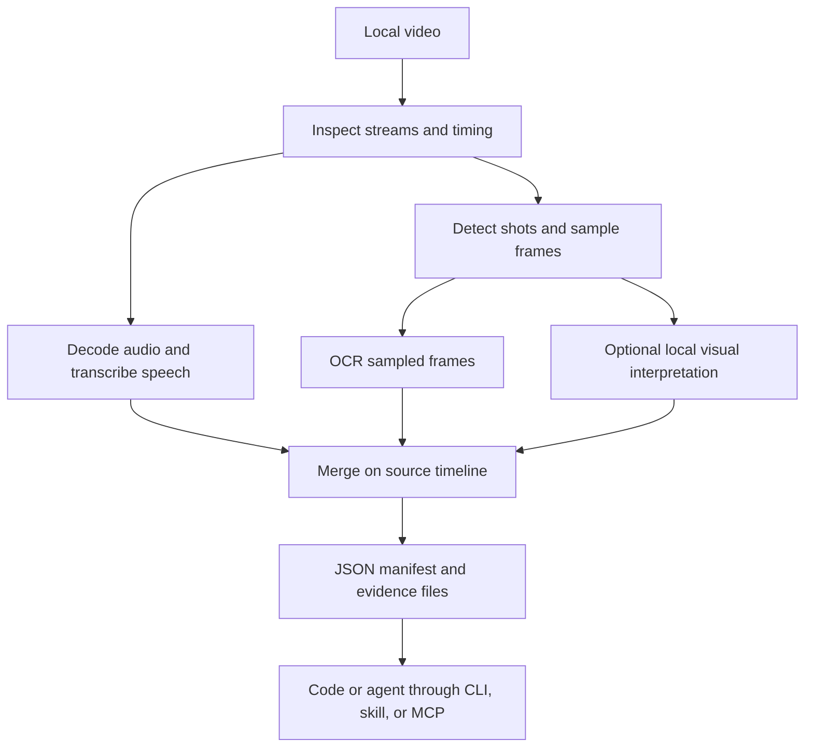

# Video context research and design

Research date: November 8, 2026.

## Objective

Build a tool that accepts a local video and returns structured context describing its shots, visible text, and speech captions. The same output should be useful to application code and to an AI coding agent. Visual descriptions and event interpretation can be added through a local vision model.

The preferred setup is free, open source, fast enough for practical use, and local. Model weights and dependencies may need an initial download. After setup, local files should be processed without network access.

The first use case is extracting context from the user's course videos. The project is a reusable local service that chatbots and other tools can call with video inputs and retrieve structured results. See [Setup and API usage](./service.md) for the implementation and operating contract. The schema below is an illustrative design; the service adds provenance, settings, and stage timing fields.

## What context means

| Information | Meaning | Source |
| --- | --- | --- |
| Metadata | Duration, dimensions, frame rate, streams, rotation | Media inspection |
| Shots | Contiguous intervals separated by detected cuts or transitions | Scene detection |
| Frames | Images sampled at recorded source timestamps | Video decoding |
| On-screen text | Words visible in slides, signs, overlays, or interfaces | OCR on frames |
| Speech captions | Spoken words with segment timing and optional word timing | Speech recognition |
| Visual descriptions | Generated descriptions of visible subjects and actions | Optional vision model |
| Events | Interpreted actions spanning time | Optional model processing short frame sequences |

A detected shot boundary is a visual transition, not necessarily a change of topic. A transcript describes speech; it does not describe everything happening visually. Generated descriptions must remain distinct from OCR and recognized speech.

## Findings from OpenMontage

[OpenMontage](https://github.com/OpenMontageInc/OpenMontage) is a broad agentic video production system. Its reference-video analysis tools are relevant even when creating or editing a new video is outside the task.

Its [VideoAnalyzer implementation](https://github.com/OpenMontageInc/OpenMontage/blob/main/tools/analysis/video_analyzer.py) orchestrates transcription, scene detection, keyframe extraction, metadata, and audio energy analysis into a JSON brief. It supports local files and URLs. Local extraction uses faster-whisper, PySceneDetect or FFmpeg, and FFmpeg frame extraction; URL workflows also use download or caption services.

The main analyzer explicitly leaves visual interpretation of the extracted keyframes to the host agent's vision model. Therefore, running this extraction code locally does not make the host agent's reasoning local. OpenMontage also has a separate, experimental [VideoUnderstand tool](https://github.com/OpenMontageInc/OpenMontage/blob/main/tools/analysis/video_understand.py) offering CLIP, BLIP-2, and LLaVA based analysis.

The repository is AGPL-3.0 licensed and includes optional paid providers for broader production workflows. For this project, use its analysis design as a reference; adopting the full production stack is not required.

## Proposed components

| Component | Purpose | Reason to consider it |
| --- | --- | --- |
| FFmpeg and ffprobe | Inspect media, decode audio and timestamped frames | Common foundation for local media processing |
| [faster-whisper](https://github.com/SYSTRAN/faster-whisper) | Speech recognition and timestamps | CPU INT8 and NVIDIA GPU inference options |
| [PySceneDetect](https://github.com/Breakthrough/PySceneDetect) | Detect shot boundaries | Content, adaptive, and threshold detection approaches |
| [PaddleOCR](https://github.com/PaddlePaddle/PaddleOCR) | Extract visible text and coordinates | Dedicated OCR stage independent of visual descriptions |
| [Qwen3-VL](https://github.com/QwenLM/Qwen3-VL) | Optional visual interpretation | Supports video and sampled-frame input |

The [Qwen3-VL-4B-Instruct model](https://huggingface.co/Qwen/Qwen3-VL-4B-Instruct) is an Apache-2.0 licensed candidate for local visual understanding. Its suitability and inference settings depend on available memory and hardware. Speech recognition remains a separate stage in this design.

Choose component versions, inference backend, and model weights during implementation. Record their licenses and versions with the environment; a wrapper's license does not establish the licenses of all dependencies and weights.

## Proposed first milestone

Input: one local video file.

Required outputs:

- A versioned JSON context manifest.
- Media metadata and audio availability.
- Shots with start and end timestamps.
- Representative frame images with actual source timestamps.
- OCR observations with frame references and bounding boxes.
- Timestamped speech segments when an audio stream contains speech.
- A speech-caption export such as SRT or WebVTT.
- Explicit completion status for each stage, including skipped or failed stages.

Visual descriptions and events are optional enrichment. A useful first release should produce evidence without requiring a large vision model.

Initial exclusions: video generation, editing, rendering, dubbing, speaker diarization, person identification, and URL downloads. These can be considered separately after local-file extraction works.

## Processing flow



Use a shared source timeline measured in seconds from the start of the video. Preserve stream offsets when aligning audio and video. Resolve frame timing from decoded source timestamps, including variable-frame-rate media, rather than estimating it from a frame number and nominal frame rate.

Shots provide navigation. Speech segments remain independent because speech can cross cuts. OCR observations belong to particular frames; merging repeated text into an interval must identify that interval as estimated from sampled observations.

## Proposed output contract

This illustrative JSON represents a successful base extraction with visual interpretation skipped. Coordinates are normalized to the displayed, rotation-corrected frame. Intervals use inclusive start and exclusive end times. IDs are unique within a manifest; references resolve to records or files in the output bundle.

```json
{
  "schema_version": "0.1.0",
  "source": {
    "file_name": "demo.mp4",
    "duration_seconds": 12.0,
    "width": 1920,
    "height": 1080,
    "has_audio": true
  },
  "status": "complete",
  "stages": {
    "shots": {"status": "complete", "engine": "pyscenedetect"},
    "frames": {"status": "complete", "engine": "ffmpeg"},
    "ocr": {"status": "complete", "engine": "paddleocr"},
    "speech": {"status": "complete", "engine": "faster-whisper"},
    "vision": {"status": "skipped", "reason": "not requested"}
  },
  "shots": [
    {"id": "shot_001", "start_seconds": 0.0, "end_seconds": 12.0,
     "frame_ids": ["frame_001"]}
  ],
  "frames": [
    {"id": "frame_001", "shot_id": "shot_001",
     "timestamp_seconds": 2.4, "path": "frames/frame_001.jpg"}
  ],
  "on_screen_text": [
    {"id": "text_001", "frame_id": "frame_001",
     "text": "Quarterly revenue", "bbox_xyxy_normalized": [0.1, 0.1, 0.6, 0.2],
     "confidence": 0.96}
  ],
  "speech_segments": [
    {"id": "speech_001", "start_seconds": 1.8, "end_seconds": 4.2,
     "text": "Revenue increased this quarter.", "language": "en"}
  ],
  "visual_descriptions": [],
  "events": [],
  "exports": {"speech_captions": "captions/speech.srt"},
  "warnings": []
}
```

The implementation should also record source identity, tool and model versions, processing settings, and timing conventions. Generated descriptions and events should reference supporting frame IDs and, when used, speech segment IDs. Do not invent confidence scores for models that do not supply meaningful scores.

Overall status should be `complete`, `partial`, or `failed`. Individual stages should distinguish `complete`, `skipped`, and `failed`, with reasons. Successful stages remain available when another stage fails. A completed speech stage can have no segments when no speech is detected; missing audio is a separate skipped condition.

## Performance approach

- Start with scene-aware sampling and a configurable periodic fallback for long shots.
- Cache expensive results using source identity, tool/model versions, and relevant settings.
- Run independent stages concurrently only within the machine's RAM and GPU limits.
- Consider CPU INT8 transcription for an initial CPU configuration; benchmark model sizes against the target language and audio quality.
- Analyze short frame sequences for motion questions. Single images cannot establish an action's complete temporal sequence.
- Allow a focused second pass over a time range with denser frames or higher resolution.

OCR on sparse frames cannot guarantee discovery of every brief text appearance. Event boundaries inferred from sampled frames have limited precision. Include sampling coverage in outputs so consumers can distinguish an observed absence from an interval that was not inspected densely.

Do not promise real-time processing before measuring on the target computer. Record video duration, wall-clock time per stage, peak RAM/VRAM, model settings, and output quality in benchmarks.

## Agent integration

| Interface | Role | Proposed timing |
| --- | --- | --- |
| Python package, CLI, and HTTP API | Execute extraction and produce durable outputs | First; implementation added |
| Skill | Explain how an agent should request extraction and inspect evidence | After real course-video validation |
| MCP server | Expose operations to compatible agents | Optional adapter over the HTTP API |
| Plugin | Package the skill, tools, and configuration | Optional distribution step |

Candidate future operations: analyze a local video, read context for a time interval, retrieve frames, and inspect a region at higher resolution. MCP should wrap the same core library rather than introduce a second extraction implementation.

A cloud-hosted agent receiving images or transcripts can send that evidence outside the computer even when extraction is local. A fully local workflow requires local extraction, local visual inference, and local agent reasoning, with dependencies and model assets already cached.

## Existing integration candidates

These projects are alternatives to evaluate, not installed or benchmarked dependencies:

- [media-context-mcp](https://github.com/vishalguptax/media-context-mcp): Apache-2.0; provides local media context including frames, transcription, and OCR.
- [watch-mcp](https://github.com/Takinggg/watch-mcp): MIT; provides timestamped storyboards, zoom, and local Whisper transcripts.
- [video-perception](https://github.com/opus-pro/video-perception): MIT; combines local scene, transcript, and frame evidence with agent interpretation.
- [video-understanding skill](https://github.com/stevederico/video-understanding): demonstrates a skill workflow combining timestamped frames and local transcription for agent interpretation.

Compare installation on Windows, output structure, timestamp handling, offline behavior, failure reporting, and retrieval of evidence before selecting a wrapper. A local MCP server is an integration mechanism, not a visual-understanding model.

## Acceptance criteria

1. A local video produces a parseable manifest and referenced evidence files without paid API credentials.
2. After assets are downloaded, extraction works with networking disabled.
3. Shot intervals are ordered and valid; a no-cut video still yields one shot spanning its playable duration.
4. Frame timestamps, audio offsets, and rotation are handled correctly, including a variable-frame-rate sample.
5. OCR results identify their source frames and valid coordinates. Repeated text does not imply unobserved exact appearance times.
6. Speech segments are ordered and can cross shots; caption exports preserve their timing.
7. Silent and no-audio videos complete without fabricated speech. Empty OCR results remain valid.
8. Corrupt or unsupported files return clear errors; a single stage failure yields usable partial output when possible.
9. Optional visual claims retain references to evidence and are labeled as model interpretations.
10. Performance is measured on representative videos, including a screen recording, presentation, talking head, and motion-heavy clip.

## Decisions still needed

- Practical processing budget. The laptop has approximately 31.8 GiB RAM, 16 logical CPU threads, and an RTX 4060 Laptop GPU with about 8 GiB VRAM; the initial configuration uses CPU inference.
- Primary video type, expected duration, and spoken/written languages.
- Whether the first release requires visual descriptions or only extracted evidence.
- Acceptable processing time and text/event coverage.

Until those are known, use a modular CPU-capable extraction design with optional GPU acceleration. Prioritize a stable JSON contract and timestamp fidelity before agent packaging.

The installed service and model checks are recorded in [Local validation](./validation.md). The [first course recording test](./course-recording-test.md) provides real-video timing, coverage, OCR observations, and Persian transcription limitations. English slides with Persian speech are the first concrete target configuration.

## Repository selection snapshot

Preference: established upstream components with substantial adoption and recent maintenance, rather than installing small unverified agent wrappers. Stars are an adoption signal, not a correctness guarantee. Values below are GitHub observations on November 8, 2026; push dates can include maintenance activity and do not guarantee a new release.

| Repository | Observed stars | Last observed push | Decision |
| --- | --- | --- | --- |
| [PaddleOCR](https://github.com/PaddlePaddle/PaddleOCR) | 92,420 | September 16, 2026 | Selected OCR backend |
| [faster-whisper](https://github.com/SYSTRAN/faster-whisper) | 26,580 | November 6, 2026 | Selected speech backend |
| [PySceneDetect](https://github.com/Breakthrough/PySceneDetect) | 5,404 | November 8, 2026 | Selected shot detector |
| [EasyOCR](https://github.com/JaidedAI/EasyOCR) | 30,130 | December 5, 2025 | Evaluated; PaddleOCR preferred for more recent activity |

FastAPI provides the HTTP interface. OpenMontage remains a production-workflow reference rather than an installed dependency. Qwen3-VL remains optional future visual enrichment; a large visual model is not needed for the first extraction service.
